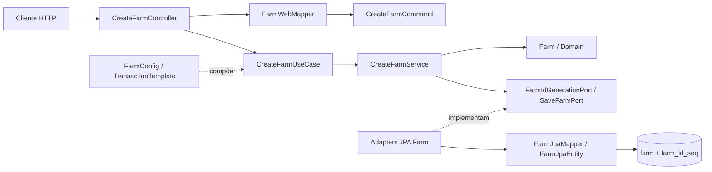
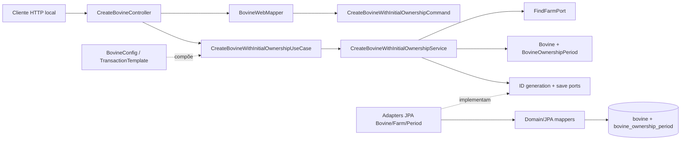

# Arquitetura hexagonal atual

Referência desta atualização: implementação local na branch `feat/bovine-ownership-period-persistence`, HEAD `559c745cf8c00bde828b3f53a62575e00e5999d3`, ainda em revisão. O BoviGestor usa arquitetura hexagonal pragmática e DDD leve. Consulte o [estado atual](../00-overview/PROJECT_CURRENT_STATE.md), o [modelo de domínio](../03-domain/DOMAIN_MODEL.md) e as [decisões](ARCHITECTURE_DECISIONS.md).

## Pacotes e responsabilidades

```text
com.bovigestor
├── domain.model                    Farm, Bovine, VOs, enums e regras
├── application.port.in             commands e interfaces de caso de uso
├── application.port.out            contratos de ID, consulta e gravação
├── application.service             coordenação pura em Java
├── adapter.in.web                  controllers, DTOs, mappers, erros e OpenAPI
├── adapter.out.persistence          entities, mappers e adapters JPA de Farm/Bovine/OwnershipPeriod
└── config                          composição Spring e fronteiras transacionais
```

`application.exceptions` contém exceções de aplicação para recurso ausente e fazenda inativa. `FarmResponse` e `BovineResponse` são usados pelos controllers de consulta. A implementação local inclui consulta/reconstituição de bovino e fazenda e persistência do primeiro período de custódia; ainda não inclui consulta de timeline ou transferência.



O fluxo bovino tem as mesmas fronteiras, habilitadas somente no perfil local `dev`:



`CreateBovineController` só é registrado com perfil `dev` e `bovigestor.bovine.creation.enabled=true`; a configuração base deixa a flag desligada. O perfil dev também vincula o HTTP a `127.0.0.1`. O guard limita o POST local, mas não substitui autenticação/autorização. `FindBovineController` e `FindFarmController` expõem GETs sem profile/flag guard; a política de segurança/exposição ainda aguarda gate e não é inferida desta implementação.

As setas de chamada não invertem a direção das dependências de código: controller importa a porta de entrada; service importa Domain e portas de saída; adapters implementam portas da Application. Domain e Application não importam Spring, JPA, Hibernate ou HTTP. O Web mapper converte `Long` para `BovineId`; não acessa persistência nem implementa regras genealógicas.

## Percurso de criação e injeção

`FarmRequest` é validado com Bean Validation e mapeado manualmente para `CreateFarmCommand`; `CreateFarmService` obtém `FarmId`, cria `Farm` usando um `Clock` injetado e invoca `SaveFarmPort`. `JpaSaveFarmAdapter` usa `FarmJpaMapper` e `EntityManager.persist()`. `JpaFarmIdGenerationAdapter` consulta `farm_id_seq`. `FarmConfig` constrói o serviço puro e oferece a implementação de `CreateFarmUseCase` dentro de `TransactionTemplate`; o commit ocorre ao sair dessa fronteira. O adapter de geração de ID também tem anotação transacional própria; ela não substitui a transação externa do caso completo.

`CreateBovineWithInitialOwnershipCommand` → `CreateBovineWithInitialOwnershipService` → Domain e ports permanecem Java puro. O serviço consulta uma fazenda ativa, gera IDs, cria bovino/período com o mesmo instante e solicita as gravações; `BovineConfig` envolve o caso inteiro em `TransactionTemplate`. Adapters JPA implementam consulta, geração e gravação; V2/V5/V6 fornecem schema/constraints. Testcontainers valida os fluxos cobertos contra PostgreSQL descartável, não o banco persistente dev.

## Erros, dados e ambientes

O `FarmWebExceptionHandler` global devolve `ProblemDetail` sanitizado: 400 para Bean Validation/JSON inválido, `IllegalArgumentException` de regras de cadastro e referências locais inexistentes (SQLState `23503`); 404 para rota/recurso ausente; 405 para método; 415 para media type; 409 para unicidade (SQLState `23505`); e 500 para erro inesperado. Não expõe SQL ou stack trace no corpo HTTP; falhas inesperadas são registradas no log.

Flyway aplica V1–V6; JPA mapeia as entities. V6 limita períodos abertos por bovino, sem impedir sobreposição entre períodos encerrados. O perfil `dev` está configurado para PostgreSQL 17 em `localhost:5433`, com credencial de variável de ambiente; conexão/schema do banco persistente não foram validados. O perfil `test` usa PostgreSQL descartável e a política de isolamento aprovada. `spring.jpa.hibernate.ddl-auto=validate` não cria schema. Não existe perfil `prod` definido.

## Testes e manutenção

Testes de domínio e Application exercitam invariantes e portas com JUnit/AssertJ/Mockito. Testes HTTP usam MockMvc para Farm e Bovine; integrações exercitam V1–V6, JPA, rollback e PostgreSQL 17 via Testcontainers. O workflow `Backend CI` executa Maven `verify` em PRs para `develop` e `main`; Docker precisa estar disponível. Ver [matriz](../01-requirements/TRACEABILITY_MATRIX.md).

Entidades concentram regras que lhes pertencem. Value Objects/DTOs imutáveis usam records quando apropriado. Não adicionar interfaces, Domain Services, Lombok ou MapStruct apenas por formalismo. Lombok, se usado, deve evitar `@Data`, setters irrestritos e igualdade automática sem semântica; MapStruct só se justifica para mapeamento estrutural repetitivo, preservando factories/invariantes. Os mapeamentos existentes são manuais.

Comparação conceitual com o estilo pragmático do CapriGestor: o BoviGestor já estabelece `domain`, `application.port`, `adapter` e `config` no próprio código; pode aproveitar lições de organização por negócio sem copiar pacotes, entidades, regras caprinas ou migrations. Esta comparação não é uma auditoria do código do CapriGestor.

## Convenções de idioma

Nomes de classes, métodos, variáveis e pacotes Java, comentários de código e mensagens de commit são escritos em inglês. Mensagens de exceções de domínio, erros de validação e erros de negócio apresentados ao usuário são escritos em português brasileiro (pt-BR). A documentação técnica e arquitetural é escrita em português brasileiro por padrão; instruções operacionais para agentes podem ser escritas em inglês quando apropriado.

Essa convenção não altera identificadores Java nem contratos técnicos de APIs. Ela também não se aplica a mensagens padrão de exceções de frameworks Java ou bibliotecas externas que o projeto não controla.
