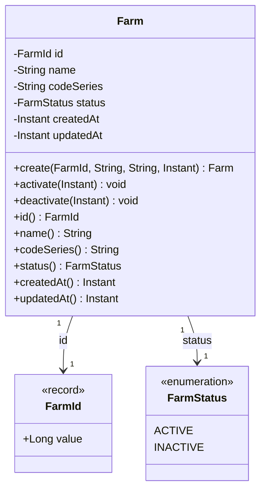
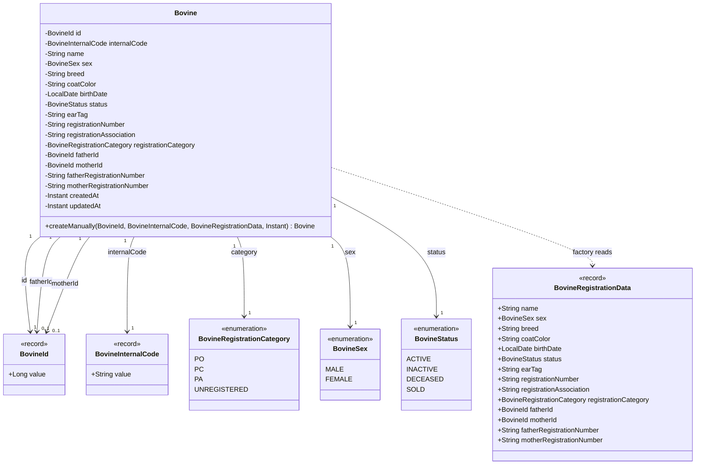
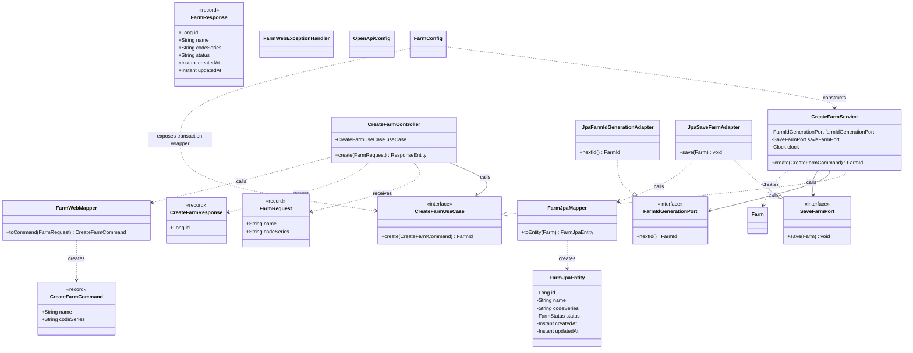
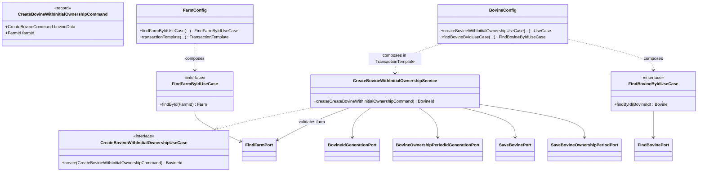
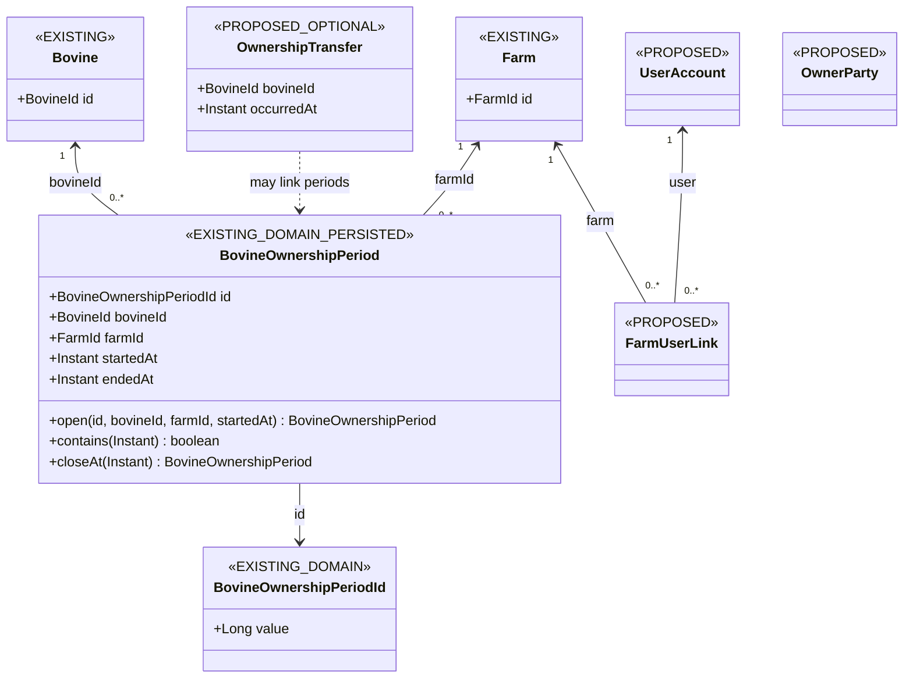
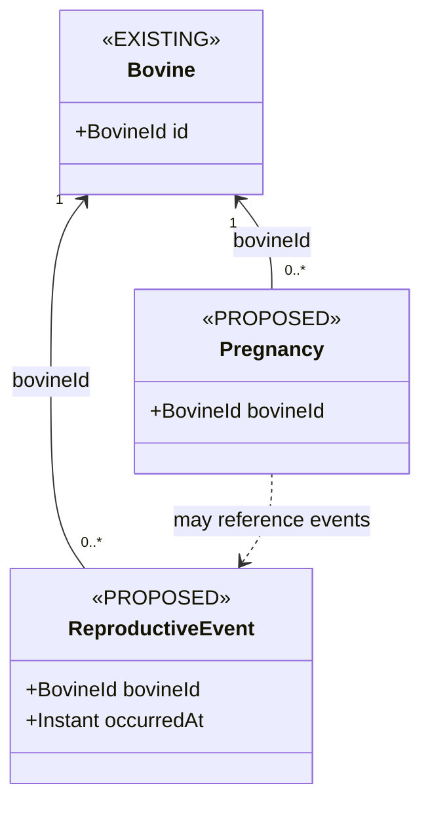
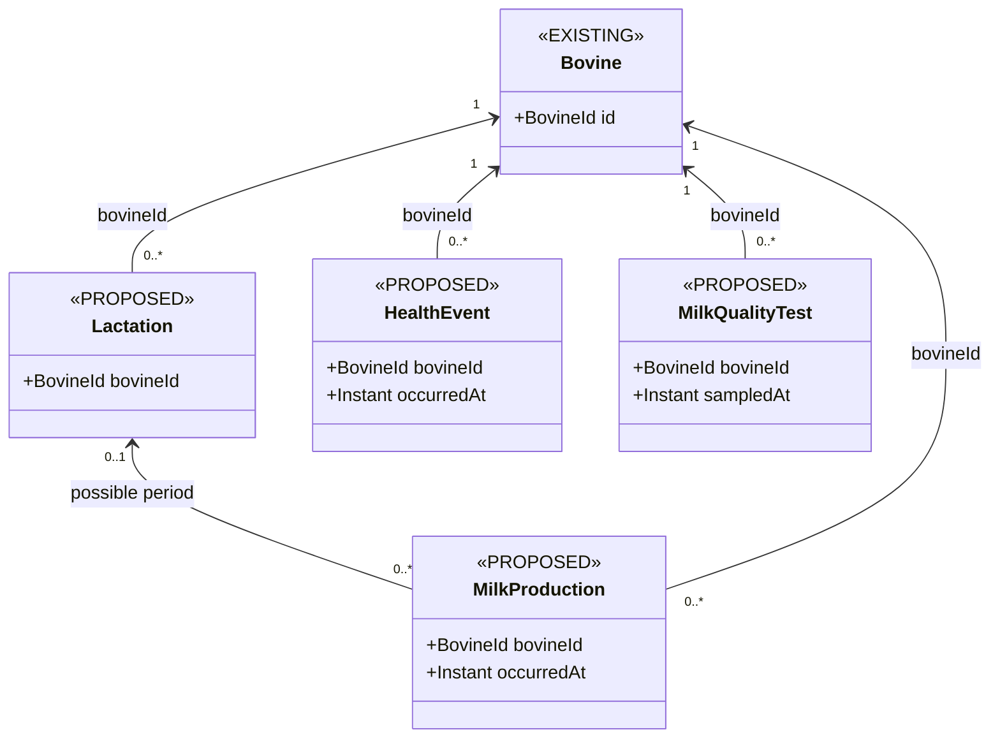

# Diagramas UML de classes

Fonte desta atualização: código local na branch `feat/bovine-ownership-period-persistence`, HEAD `559c745cf8c00bde828b3f53a62575e00e5999d3`, aguardando revisão independente. **Seção A = componentes existentes localmente. Seção B = desenho conceitual PROPOSED**. `BovineOwnershipPeriod` e seu ID possuem Domain, entity/mapper JPA, V5/V6 e primeiro período no cadastro; consulta de timeline e transferência não existem. O limite de agregado do período segue em discussão. O código não declara interface Java `AggregateRoot`. Ver [modelo de domínio](../03-domain/DOMAIN_MODEL.md) e [ADRs](../01-architecture/ARCHITECTURE_DECISIONS.md).

## A. Modelo atual

### A1. Raiz de agregado `Farm`

### A2. Raiz de agregado `Bovine` e Value Objects

`BovineRegistrationData` é parâmetro da factory, **não** entidade persistente. `Bovine` retém `BovineOrigin`, tem accessors e factory `reconstitute` que preserva os dados reconstruídos do JPA; não possui transições públicas de estado. As setas para `BovineId` representam valores, não relacionamentos navegáveis com objetos `Bovine`.

### A3. Caso de uso e adapters de fazenda

`FindFarmController` usa `FarmResponse` e o fluxo de consulta está implementado localmente. A política de exposição/autorização do GET ainda aguarda revisão.

### A4. Application: cadastro operacional e consultas

O serviço rejeita fazenda ausente/inativa antes de gerar IDs e cria `Bovine` e o primeiro período com o mesmo instante do `Clock`. A composição Spring envolve as duas gravações em uma transação externa.

### A5. Web, queries and persistence (local implementation)

```mermaid
classDiagram
    class CreateBovineController {
        +create(BovineRequest) ResponseEntity
    }
    class FindBovineController {
        +findById(Long) ResponseEntity
    }
    class FindFarmController {
        +findById(Long) ResponseEntity
    }
    class BovineWebMapper {
        +toOperationalCommand(BovineRequest) CreateBovineWithInitialOwnershipCommand
        +toResponse(Bovine) BovineResponse
    }
    class FindBovineControllerHttpTest
    class FindFarmControllerHttpTest
    class BovineJpaMapper {
        +toEntity(Bovine) BovineJpaEntity
        +toDomain(BovineJpaEntity) Bovine
    }
    class FarmJpaMapper {
        +toEntity(Farm) FarmJpaEntity
        +toDomain(FarmJpaEntity) Farm
    }
    class BovineOwnershipPeriodJpaMapper {
        +toEntity(BovineOwnershipPeriod) Entity
        +toDomain(Entity) BovineOwnershipPeriod
    }
    class BovineOwnershipPeriodJpaEntity
    class V5
    class V6
    CreateBovineController --> CreateBovineWithInitialOwnershipUseCase
    CreateBovineController ..> BovineWebMapper
    FindBovineController --> FindBovineByIdUseCase
    FindBovineController ..> BovineWebMapper
    FindFarmController --> FindFarmByIdUseCase
    BovineJpaMapper ..> BovineJpaEntity
    FarmJpaMapper ..> FarmJpaEntity
    BovineOwnershipPeriodJpaMapper ..> BovineOwnershipPeriodJpaEntity
    V5 ..> BovineOwnershipPeriodJpaEntity : schema
    V6 ..> BovineOwnershipPeriodJpaEntity : one open period index
```

O POST `/api/v1/bovines` é registrado somente em `dev` com sua feature flag. Os controllers GET não têm guard de profile/flag/autenticação; exposição e autorização seguem pendentes de revisão separada. Domain e Application permanecem independentes de Spring/JPA/HTTP.

## B. Modelo conceitual futuro — PROPOSED

`BovineOwnershipPeriod` e `BovineOwnershipPeriodId` são implementados localmente no Domain e na persistência V5/V6. Os demais conceitos abaixo são candidatos. Cardinalidades descrevem hipóteses; associações não definem automaticamente cascata JPA ou transação. `BovineId` permanece estável.

### B1. Titularidade e pessoas

`BovineOwnershipPeriod` e `BovineOwnershipPeriodId` existem no Domain e no mapeamento/persistência local: V5 cria a tabela e sequence, e V6 limita períodos abertos. O fluxo de cadastro abre o período inicial; leitura da timeline e transferência não existem. `OwnerParty`, `UserAccount` e seus vínculos continuam sem identidade, campos ou cardinalidade final definidos. `OwnershipTransfer` pode ser desnecessário se períodos e auditoria forem suficientes. O período referencia `BovineId` e `FarmId`, sem navegação direta entre agregados.

### B2. Reprodução

IATF, diagnóstico e desfechos são candidatos a eventos/tipos; campos, período gestacional e regras de estado exigem especialista. `Pregnancy` pode ser projeção de eventos ou entidade própria; decisão aberta.

### B3. Lactação, produção, sanidade e qualidade

`MilkProduction` pode representar ordenha individual ou outra granularidade a decidir. A referência à lactação é opcional **apenas na hipótese acima**; não é regra aprovada. Medicação, carência, mastite, CCS/CBT e descarte dependem de critérios técnicos e regulatórios. Cada conjunto de eventos pode exigir seu próprio limite de consistência, sem ampliar automaticamente o agregado `Bovine`.
