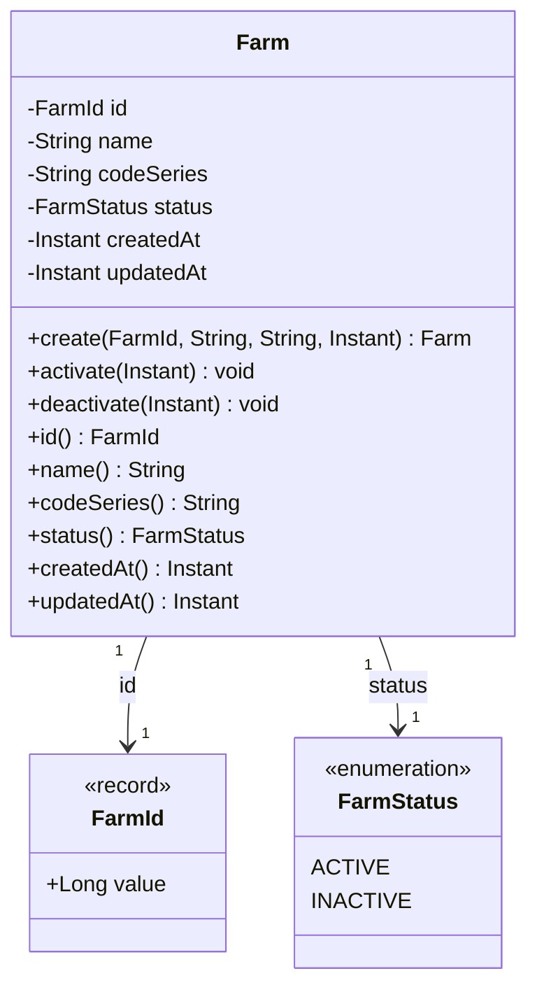
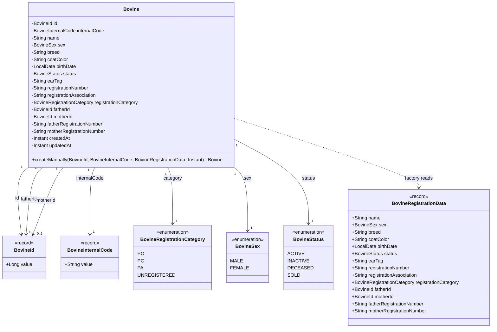
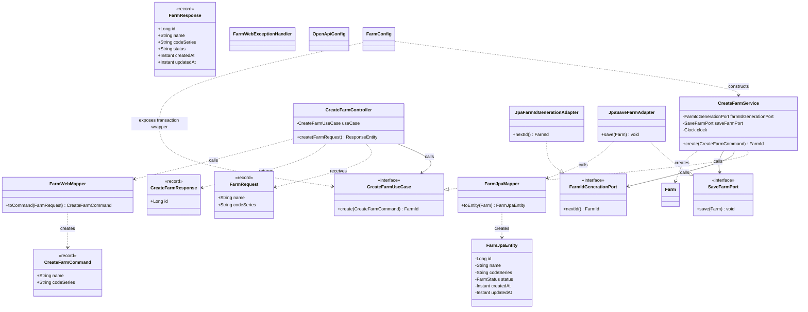
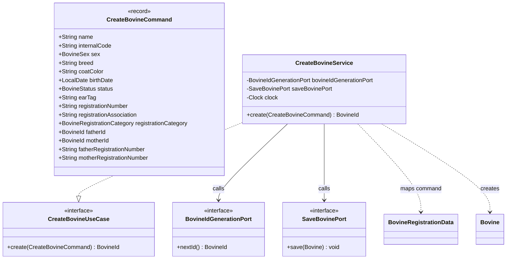
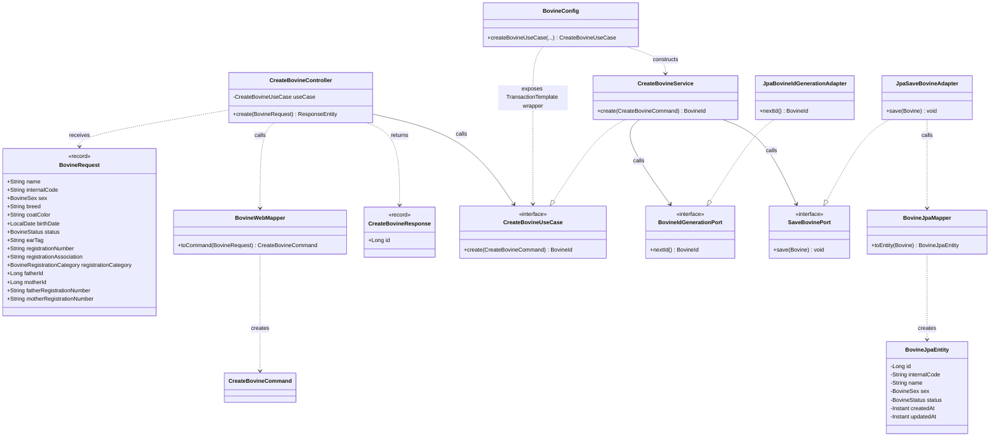
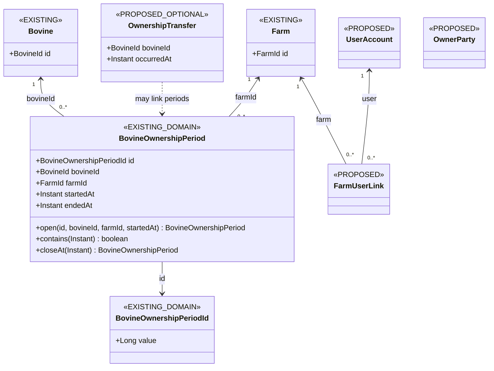
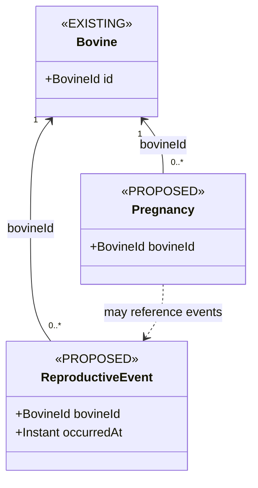
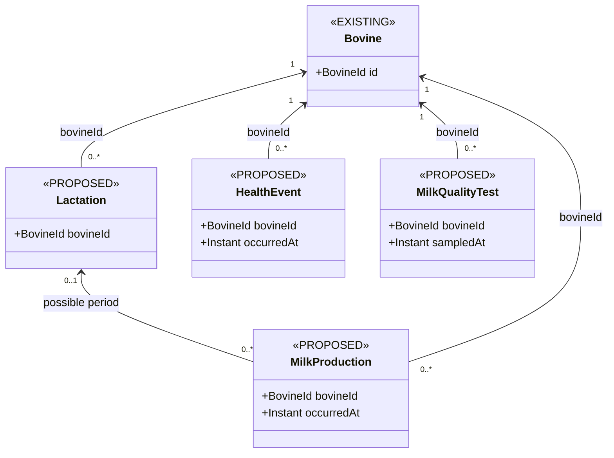

# Diagramas UML de classes

Fonte: implementação da branch `feat/bovine-web-01`, baseada em `7257c2bce524274bad106a5894bde7c8b98a4286`. **Seção A = código existente. Seção B = desenho conceitual PROPOSED para evolução**; `BovineOwnershipPeriod` e `BovineOwnershipPeriodId` já existem apenas no Domain, sem persistência JPA/tabela ou fluxo operacional. `Farm` e `Bovine` são tratadas como raízes de agregados independentes; o limite de agregado de `BovineOwnershipPeriod` permanece em discussão. O código não declara interface Java `AggregateRoot`. Ver [modelo de domínio](../03-domain/DOMAIN_MODEL.md) e [ADRs](../01-architecture/ARCHITECTURE_DECISIONS.md).

## A. Modelo atual

### A1. Raiz de agregado `Farm`

### A2. Raiz de agregado `Bovine` e Value Objects

`BovineRegistrationData` é parâmetro da factory, **não** campo retido nem entidade persistente. As setas para `BovineId` representam campos de valor, não relacionamentos navegáveis com objetos `Bovine`. `Bovine` oferece accessors públicos de leitura, mas não possui transições públicas de estado nem factory de reconstituição.

### A3. Caso de uso e adapters de fazenda

`FarmResponse` está desenhado por existir no código, mas não está ligado ao controller: nenhuma consulta foi implementada. `FarmWebExceptionHandler` e `OpenApiConfig` são componentes Web existentes sem associação de domínio.

### A4. Caso de uso bovino — Application

O diagrama mostra o limite Application. A composição transacional, os adapters JPA e o adapter Web estão no diagrama A5.

### A5. Fluxo Web e persistência técnica de bovino (perfil dev)

`CreateBovineController` só existe no contexto `dev` quando a feature flag está habilitada; o bind dev usa loopback. A relação com JPA termina em `BovineJpaEntity`, sem referência direta à fazenda. Não há titularidade inicial ou autorização operacional nesse fluxo.

## B. Modelo conceitual futuro — PROPOSED

Os tipos `BovineOwnershipPeriod` e `BovineOwnershipPeriodId` já existem no Domain; os demais conceitos abaixo são candidatos. Cardinalidades descrevem hipóteses para discussão; associações não definem automaticamente cascata JPA, persistência ou transação. O `BovineId` continua estável e os vínculos referenciam IDs técnicos.

### B1. Titularidade e pessoas

`BovineOwnershipPeriod` e `BovineOwnershipPeriodId` são tipos existentes somente no Domain; não há entity JPA, tabela, geração persistente do ID ou caso de uso operacional. `OwnerParty`, `UserAccount` e seus vínculos ainda não têm identidade, campos ou cardinalidade final definidos. Por isso, `OwnerParty` aparece sem associação: decidir se proprietário é usuário, pessoa distinta ou papel no vínculo. `OwnershipTransfer` pode ser desnecessário se os períodos e a auditoria forem suficientes. O período referencia `BovineId` e `FarmId`, sem composição com `Bovine` ou `Farm`; uma transferência candidata atualiza períodos em uma transação.

### B2. Reprodução

IATF, diagnóstico e desfechos são candidatos a eventos/tipos; campos, período gestacional e regras de estado exigem especialista. `Pregnancy` pode ser projeção de eventos ou entidade própria; decisão aberta.

### B3. Lactação, produção, sanidade e qualidade

`MilkProduction` pode representar ordenha individual ou outra granularidade a decidir. A referência à lactação é opcional **apenas na hipótese acima**; não é regra aprovada. Medicação, carência, mastite, CCS/CBT e descarte dependem de critérios técnicos e regulatórios. Cada conjunto de eventos pode exigir seu próprio limite de consistência, sem ampliar automaticamente o agregado `Bovine`.
