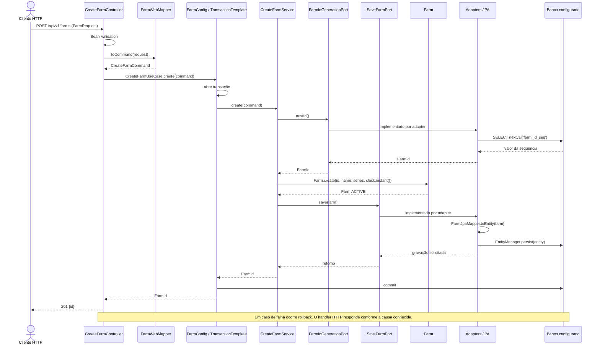
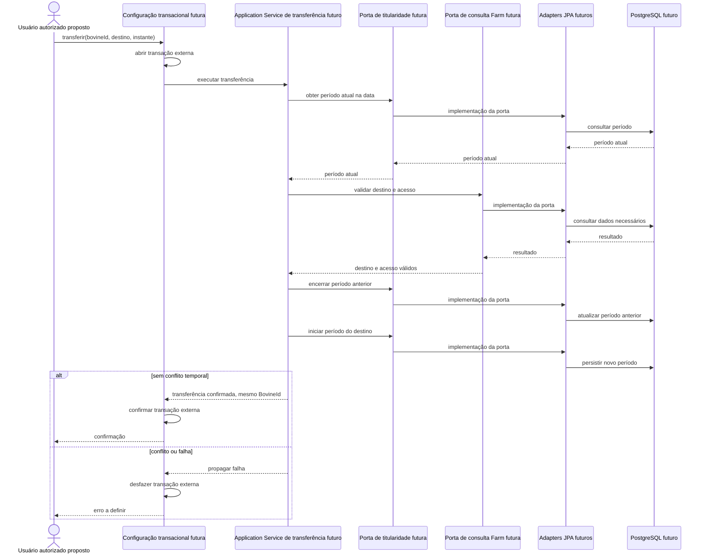
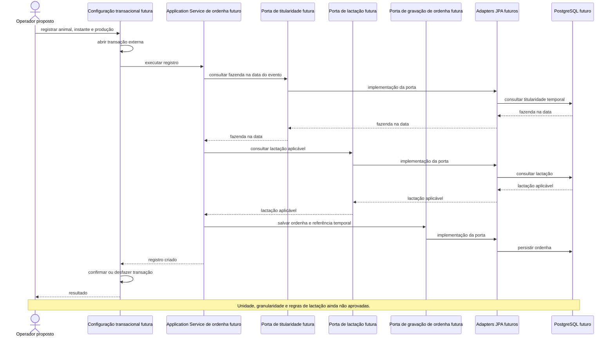
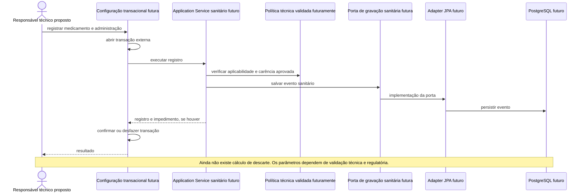
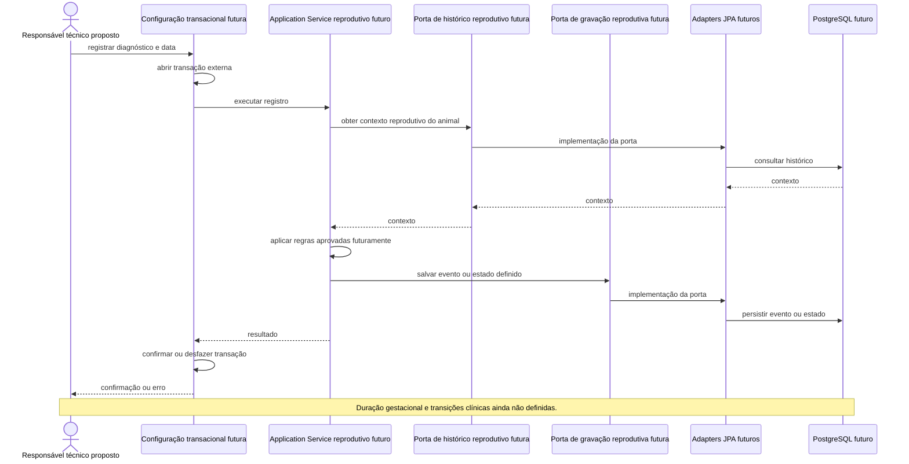

# Diagramas de sequência

Fonte desta atualização: código local na branch `feat/bovine-ownership-period-persistence`, HEAD `559c745cf8c00bde828b3f53a62575e00e5999d3`, aguardando revisão. **IMPLEMENTED** descreve apenas o comportamento local; **PROPOSED** continua sem implementação. Integrações usam PostgreSQL descartável via Testcontainers; o banco persistente dev não foi validado. Veja [arquitetura](../01-architecture/ARCHITECTURE.md) e [casos de uso](../02-use-cases/USE_CASE_CATALOG.md).

## UC-001 — criar fazenda (IMPLEMENTED)



O diagrama mostra chamadas lógicas das portas aos adapters; o código não faz a porta invocar concretamente o adapter. A injeção Spring liga implementação e interface. O SQL de inserção pode ser enviado no flush/commit, não necessariamente no instante de `persist()`.

## UC-004/005 — criar bovino com custódia inicial (IMPLEMENTED localmente; POST somente dev+flag)

```mermaid
sequenceDiagram
    actor Client as Cliente HTTP local
    participant Web as CreateBovineController
    participant Mapper as BovineWebMapper
    participant UseCase as CreateBovineWithInitialOwnershipUseCase
    participant Config as BovineConfig / TransactionTemplate
    participant Service as CreateBovineWithInitialOwnershipService
    participant FarmPort as FindFarmPort
    participant IdPort as BovineIdGenerationPort
    participant Code as BovineInternalCode
    participant Domain as Bovine
    participant SavePort as SaveBovinePort + SaveBovineOwnershipPeriodPort
    participant Jpa as Adapters JPA bovino/fazenda/período
    participant DB as PostgreSQL descartável em teste
    Client->>Web: POST /api/v1/bovines (BovineRequest)
    Web->>Web: Bean Validation
    Web->>Mapper: toCommand(request)
    Mapper-->>Web: CreateBovineWithInitialOwnershipCommand
    Web->>UseCase: create(command)
    Config->>Config: abrir transação
    Config->>Service: create(command)
    Service->>FarmPort: findById(farmId)
    FarmPort->>Jpa: consultar fazenda
    Jpa->>DB: EntityManager.find(FarmJpaEntity)
    DB-->>Jpa: fazenda ou ausência
    Jpa-->>FarmPort: resultado
    FarmPort-->>Service: fazenda ativa
    Service->>IdPort: nextId()
    IdPort->>Jpa: implementação da porta
    Jpa->>DB: SELECT nextval('bovine_id_seq')
    DB-->>Jpa: valor da sequência
    Jpa-->>IdPort: BovineId
    IdPort-->>Service: BovineId
    Service->>Code: new(command.internalCode())
    Service->>Service: toRegistrationData(command)
    Service->>Domain: createManually(id, code, data+origin, clock.instant())
    Domain-->>Service: Bovine validado
    Service->>SavePort: save(bovine)
    SavePort->>Jpa: implementação da porta
    Jpa->>DB: EntityManager.persist(entity)
    Jpa-->>SavePort: persistência solicitada
    SavePort-->>Service: retorno
    Service->>Service: abrir OwnershipPeriod com mesmo instante
    Service->>SavePort: save(period)
    SavePort->>Jpa: implementar porta do período
    Jpa->>DB: persistir período aberto
    DB-->>Jpa: persistência aceita
    Jpa-->>SavePort: retorno
    Service-->>Config: BovineId
    Config->>DB: commit da transação externa
    Config-->>Web: BovineId
    Web-->>Client: 201 {id}
    Note over Web,DB: Fazenda inexistente/inativa falha antes de gerar IDs. Erro após flush causa rollback. POST somente dev+flag; não há autenticação/autorização.
```

O teste de criação PostgreSQL usa Testcontainers descartável. Testes de rollback confirmam que falha ao salvar o período desfaz o bovino. O POST usa `Clock.instant()` como início; entrada retroativa não está implementada. O fluxo local não aprova exposição de produção. A transferência e a consulta de timeline seguem futuras.

## UC-010 — transferir entre fazendas (PROPOSED)



Concorrência, vigência retroativa e saídas externas ainda precisam de regra aprovada; índice único parcial para período aberto é apenas candidato.

## UC-016 — registrar ordenha (PROPOSED)



## UC-017 — registrar medicação e carência (PROPOSED)



## UC-014 — diagnóstico gestacional (PROPOSED)


