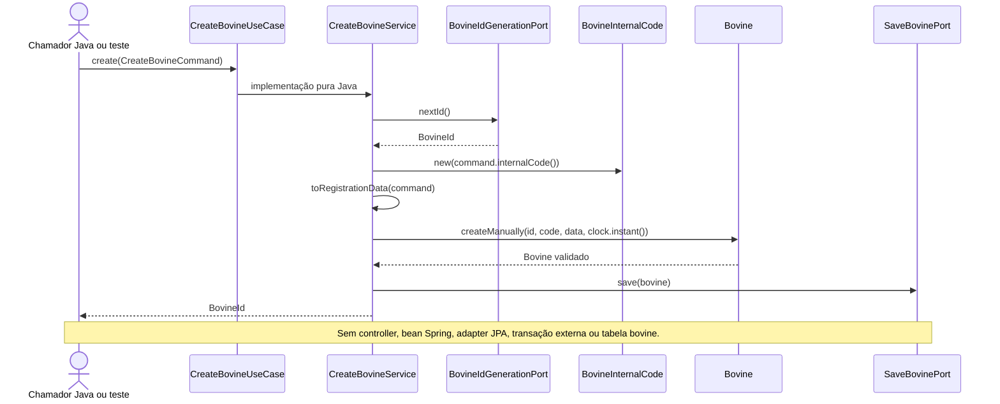
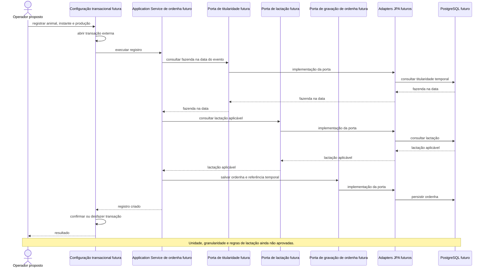
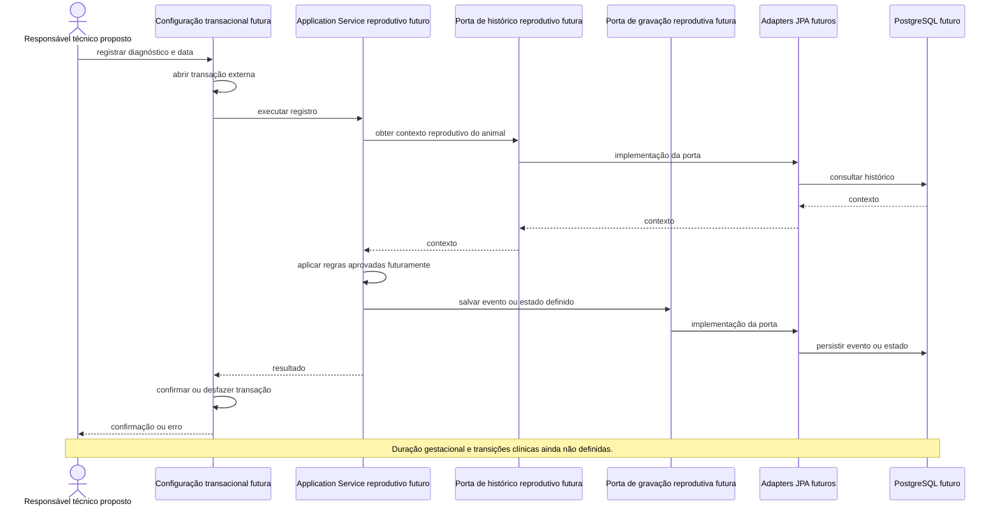

# Diagramas de sequência

Fonte: `develop` em `0804e609857d22983e9839f7c844b1e45b2b40a0`. Os rótulos **IMPLEMENTED**, **PARTIAL** e **PROPOSED** delimitam o que o código executa hoje. PostgreSQL é o banco do perfil `dev`; os testes de integração usam H2. Veja [arquitetura](../01-architecture/ARCHITECTURE.md) e [casos de uso](../02-use-cases/USE_CASE_CATALOG.md).

## UC-001 — criar fazenda (IMPLEMENTED)

```mermaid
sequenceDiagram
    actor Client as Cliente HTTP
    participant Web as CreateFarmController
    participant Mapper as FarmWebMapper
    participant Tx as FarmConfig / TransactionTemplate
    participant Service as CreateFarmService
    participant IdPort as FarmIdGenerationPort
    participant SavePort as SaveFarmPort
    participant Domain as Farm
    participant Jpa as Adapters JPA
    participant DB as Banco configurado
    Client->>Web: POST /api/v1/farms (FarmRequest)
    Web->>Web: Bean Validation
    Web->>Mapper: toCommand(request)
    Mapper-->>Web: CreateFarmCommand
    Web->>Tx: CreateFarmUseCase.create(command)
    Tx->>Tx: abre transação
    Tx->>Service: create(command)
    Service->>IdPort: nextId()
    IdPort->>Jpa: implementado por adapter
    Jpa->>DB: SELECT nextval('farm_id_seq')
    DB-->>Jpa: valor da sequência
    Jpa-->>IdPort: FarmId
    IdPort-->>Service: FarmId
    Service->>Domain: Farm.create(id, name, series, clock.instant())
    Domain-->>Service: Farm ACTIVE
    Service->>SavePort: save(farm)
    SavePort->>Jpa: implementado por adapter
    Jpa->>Jpa: FarmJpaMapper.toEntity(farm)
    Jpa->>DB: EntityManager.persist(entity)
    Jpa-->>SavePort: gravação solicitada
    SavePort-->>Service: retorno
    Service-->>Tx: FarmId
    Tx->>DB: commit
    Tx-->>Web: FarmId
    Web-->>Client: 201 {id}
    Note over Web,DB: Em falha, rollback; handler HTTP responde 400, 405, 409, 415 ou 500 conforme a causa conhecida.
```

O diagrama mostra chamadas lógicas das portas aos adapters; o código não faz a porta invocar concretamente o adapter. A injeção Spring liga implementação e interface. O SQL de inserção pode ser enviado no flush/commit, não necessariamente no instante de `persist()`.

## UC-004 — criar bovino (PARTIAL: Domain/Application)



`UseCase` e `Service` são o mesmo objeto de implementação quando composto; a seta intermediária explicita o contrato. Os testes usam mocks das portas, portanto não comprovam gravação real.

## UC-005 — criação com titularidade inicial (PROPOSED)

Os participantes de infraestrutura e as portas nos fluxos **PROPOSED** abaixo são papéis conceituais, não classes ou contratos já criados. As setas de uma porta a um adapter representam o despacho para a implementação configurada externamente; a interface não executa código de persistência.

```mermaid
sequenceDiagram
    actor Actor as Usuário autorizado proposto
    participant Web as Controller futuro
    participant Tx as Configuração transacional futura
    participant App as Application Service futuro
    participant FarmPort as Porta de consulta Farm futura
    participant Bovine as Bovine
    participant Ownership as BovineOwnershipPeriod futuro
    participant BovinePort as Porta de gravação Bovine futura
    participant OwnershipPort as Porta de gravação da titularidade futura
    participant Jpa as Adapters JPA futuros
    participant DB as PostgreSQL futuro
    Actor->>Web: solicitar cadastro com fazenda
    Web->>Tx: executar caso de uso com comando e contexto
    Tx->>Tx: abrir transação externa
    Tx->>App: criar bovino e titularidade inicial
    App->>FarmPort: verificar fazenda e acesso
    FarmPort->>Jpa: implementação da porta
    Jpa->>DB: consultar dados necessários
    DB-->>Jpa: resultado
    Jpa-->>FarmPort: resultado
    FarmPort-->>App: fazenda e acesso válidos
    App->>Bovine: criar agregado
    App->>Ownership: criar primeiro período
    App->>BovinePort: salvar bovino
    BovinePort->>Jpa: implementação da porta
    Jpa->>DB: persistir bovino
    App->>OwnershipPort: salvar período inicial
    OwnershipPort->>Jpa: implementação da porta
    Jpa->>DB: persistir período
    alt ambos válidos
        App-->>Tx: ID do bovino
        Tx->>Tx: confirmar transação externa
        Tx-->>Web: ID do bovino
        Web-->>Actor: resposta a definir
    else falha de qualquer gravação
        App-->>Tx: propagar falha
        Tx->>Tx: desfazer transação externa
        Tx-->>Web: erro a definir
        Web-->>Actor: resposta a definir
    end
    Note over Web,DB: Contrato do command e titularidade obrigatória aguardam ADR-007; nenhuma porta ou adapter futuros existe hoje.
```

## UC-010 — transferir entre fazendas (PROPOSED)

```mermaid
sequenceDiagram
    actor Actor as Usuário autorizado proposto
    participant Tx as Configuração transacional futura
    participant App as Application Service de transferência futuro
    participant OwnerPort as Porta de titularidade futura
    participant FarmPort as Porta de consulta Farm futura
    participant Jpa as Adapters JPA futuros
    participant DB as PostgreSQL futuro
    Actor->>Tx: transferir(bovineId, destino, instante)
    Tx->>Tx: abrir transação externa
    Tx->>App: executar transferência
    App->>OwnerPort: obter período atual na data
    OwnerPort->>Jpa: implementação da porta
    Jpa->>DB: consultar período
    DB-->>Jpa: período atual
    Jpa-->>OwnerPort: período atual
    OwnerPort-->>App: período atual
    App->>FarmPort: validar destino e acesso
    FarmPort->>Jpa: implementação da porta
    Jpa->>DB: consultar dados necessários
    DB-->>Jpa: resultado
    Jpa-->>FarmPort: resultado
    FarmPort-->>App: destino e acesso válidos
    App->>OwnerPort: encerrar período anterior
    OwnerPort->>Jpa: implementação da porta
    Jpa->>DB: atualizar período anterior
    App->>OwnerPort: iniciar período do destino
    OwnerPort->>Jpa: implementação da porta
    Jpa->>DB: persistir novo período
    alt sem conflito temporal
        App-->>Tx: transferência confirmada, mesmo BovineId
        Tx->>Tx: confirmar transação externa
        Tx-->>Actor: confirmação
    else conflito ou falha
        App-->>Tx: propagar falha
        Tx->>Tx: desfazer transação externa
        Tx-->>Actor: erro a definir
    end
```

Concorrência, vigência retroativa e saídas externas ainda precisam de regra aprovada; índice único parcial para período aberto é apenas candidato.

## UC-016 — registrar ordenha (PROPOSED)



## UC-017 — registrar medicação e carência (PROPOSED)

```mermaid
sequenceDiagram
    actor Vet as Responsável técnico proposto
    participant Tx as Configuração transacional futura
    participant App as Application Service sanitário futuro
    participant Rule as Política técnica validada futuramente
    participant HealthPort as Porta de gravação sanitária futura
    participant Jpa as Adapter JPA futuro
    participant DB as PostgreSQL futuro
    Vet->>Tx: registrar medicamento e administração
    Tx->>Tx: abrir transação externa
    Tx->>App: executar registro
    App->>Rule: verificar aplicabilidade e carência aprovada
    App->>HealthPort: salvar evento sanitário
    HealthPort->>Jpa: implementação da porta
    Jpa->>DB: persistir evento
    App-->>Tx: registro e impedimento, se houver
    Tx->>Tx: confirmar ou desfazer transação
    Tx-->>Vet: resultado
    Note over Vet,DB: Não existe cálculo de descarte; parâmetros dependem de validação técnica/regulatória.
```

## UC-014 — diagnóstico gestacional (PROPOSED)


