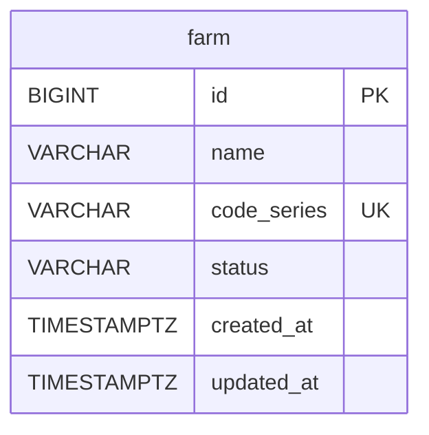
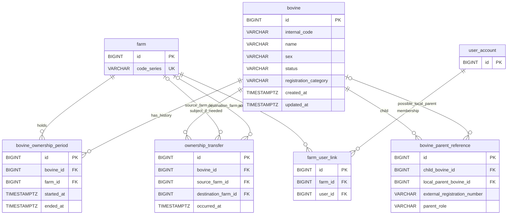
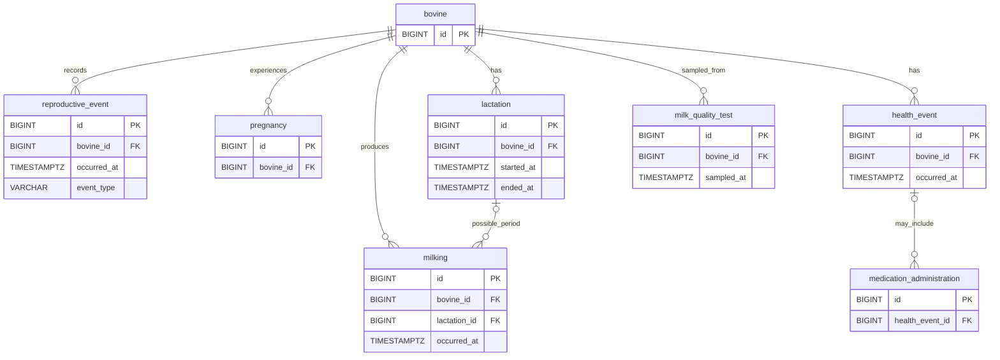

# Modelo relacional e evolução proposta

Fonte atual: [migration V1](../../src/main/resources/db/migration/V1__create_farm_schema.sql), `FarmJpaEntity` e `develop` em `0804e609857d22983e9839f7c844b1e45b2b40a0`. A seção **existente** descreve a base; a seção **PROPOSED** é planejamento, sem SQL executado. Ver [ADRs](../01-architecture/ARCHITECTURE_DECISIONS.md) e [modelo de domínio](../03-domain/DOMAIN_MODEL.md).

## Schema existente — V1

V1 também cria a sequência `farm_id_seq` (início 1, incremento 1), que não é tabela ER. `farm.id` é PK, `NOT NULL` e `> 0`; `name` é `VARCHAR(255) NOT NULL` com `TRIM(name)` não vazio; `code_series` é `VARCHAR(4) NOT NULL UNIQUE`; `status` é `VARCHAR(20) NOT NULL` limitado a `ACTIVE`/`INACTIVE`; timestamps são `TIMESTAMP WITH TIME ZONE NOT NULL`. Não existem FKs, índices adicionais declarados ou exclusão lógica. A expressão `[A-Z]{3,4}` é validada no domínio/Web, **não** por CHECK na V1. A entidade JPA é separada de `Farm` e `FarmJpaMapper` converte Domain → JPA.

## Modelo PROPOSED — identidade, genealogia e titularidade

Os nomes abaixo são candidatos para discussão. `farm` é a única tabela implementada. O mesmo `bovine.id` técnico continuaria válido depois de transferência; a fazenda atual **não** faria parte da identidade do bovino. O vínculo temporal ficaria em períodos separados.

`bovine_parent_reference` é **uma alternativa** para os atuais campos `fatherId`, `motherId` e números externos; guardar esses campos diretamente em `bovine` também é possível. Não criar tabela própria sem demanda de consulta e decisão sobre cardinalidade. `ownership_transfer` é opcional; os períodos podem bastar, com auditoria separada. Nesse desenho **PROPOSED**, as duas relações de `ownership_transfer` com `farm` têm papéis distintos: `source_farm_id` indica a fazenda de origem e `destination_farm_id` indica a fazenda de destino. A obrigatoriedade de cada vínculo e o modelo de transferência ainda dependem das ADR-007/008. `user_account`, `farm_user_link` e eventual `owner_party` não têm modelo de identidade aprovado. A cardinalidade ER acima é proposta para orientar discussão, não contrato de JPA.

### Constraints e índices candidatos

| Tema | Proposta a revisar |
| --- | --- |
| Identidade | `bovine.id` como PK técnica; `bovine.internal_code` com política de unicidade a definir. O padrão do VO sozinho não garante unicidade nem vincula a série da fazenda. |
| Registro genealógico | Categoria, número, associação e genitores coerentes com a factory; decidir quais regras podem ser CHECK e quais exigem validação entre tabelas. Referências externas não geram FK local. |
| Genitor local | FK opcional para `bovine.id`; impedir autorreferência e decidir como detectar ciclos indiretos. |
| Titularidade ativa | Candidato: índice único parcial PostgreSQL por `bovine_id` quando `ended_at IS NULL`, para no máximo um período aberto. Não impede sobreposição entre períodos fechados. |
| Intervalos temporais | Definir limites inclusivos/exclusivos, fuso, retroatividade e validação de sobreposição. Eventual exclusão temporal PostgreSQL requer projeto e teste de concorrência. |
| Transferência | Fechar período anterior e abrir novo na mesma transação; manter histórico e `BovineId`; definir como tratar saída externa. |
| Exclusão lógica | Ainda não decidida. Não substituir histórico por remoção; definir retenção e status conforme regras de negócio. |
| Rastreabilidade | Timestamps, vínculo da ação com usuário e correlação de eventos são candidatos, sujeitos à política de auditoria e privacidade. |

## Modelo PROPOSED — reprodução, leite, sanidade e qualidade

Cada tabela candidata referencia a identidade técnica bovina. A pertença à fazenda em um evento deve ser obtida pela titularidade **na data do evento**, se essa regra for aprovada, e não por uma coluna permanente `current_farm_id` no animal.

`MilkProduction` no diagrama de domínio é conceito; `milking` é uma hipótese de granularidade para persistência. Definir unidade/volume, amostra, laboratório, rastreio de lote, protocolos IATF, eventos de parto e medicação somente com requisitos aprovados. Não há prazo gestacional, carência, limite CCS/CBT nem obrigação SISBOV definidos neste documento.

## Estratégia de migração

A V1 já existe e não deve ser recriada ou editada retroativamente para introduzir bovinos. Qualquer V2 futura precisa de gate próprio, teste H2/PostgreSQL e análise de dados/índices. O baseline atual usa H2 em integração; compatibilidade PostgreSQL ainda exige validação direta. Nenhuma migration foi criada nesta tarefa.
