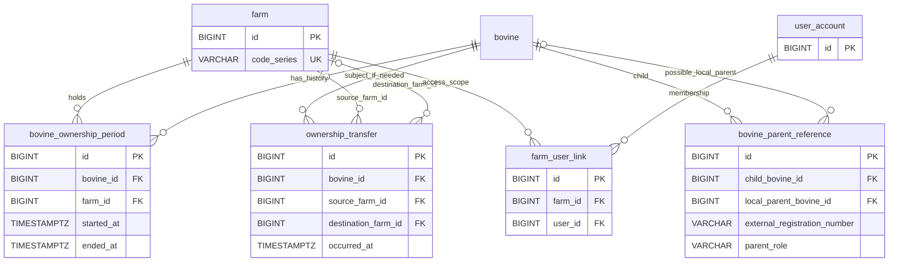
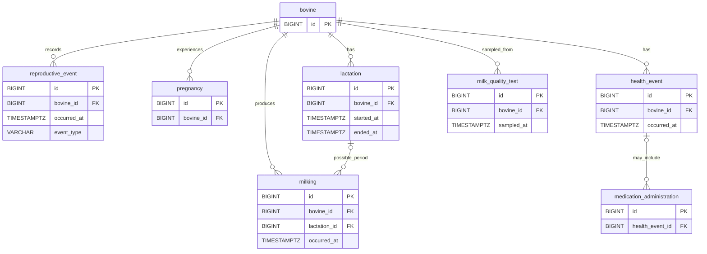

# Modelo relacional e evolução proposta

Fonte desta atualização: migrations [V1–V6](../../src/main/resources/db/migration), entities JPA e código local na branch `feat/bovine-ownership-period-persistence`, HEAD `559c745cf8c00bde828b3f53a62575e00e5999d3`, aguardando revisão. A seção existente descreve o SQL local; a seção **PROPOSED** permanece planejamento. Ver [ADRs](../01-architecture/ARCHITECTURE_DECISIONS.md) e [modelo de domínio](../03-domain/DOMAIN_MODEL.md).

## Schema existente — V1 a V6

```mermaid
erDiagram
    farm {
        BIGINT id PK
        VARCHAR name
        VARCHAR code_series UK
        VARCHAR status
        TIMESTAMPTZ created_at
        TIMESTAMPTZ updated_at
    }
    bovine {
        BIGINT id PK
        VARCHAR internal_code UK
        VARCHAR name
        VARCHAR sex
        VARCHAR breed
        VARCHAR coat_color
        DATE birth_date
        VARCHAR status
        VARCHAR ear_tag
        VARCHAR registration_number
        VARCHAR registration_association
        VARCHAR registration_category
        VARCHAR origin_creator_name
        VARCHAR origin_farm_name
        BIGINT origin_farm_id FK
        BIGINT father_id FK
        BIGINT mother_id FK
        VARCHAR father_registration_number
        VARCHAR mother_registration_number
        TIMESTAMPTZ created_at
        TIMESTAMPTZ updated_at
    }
    bovine_ownership_period {
        BIGINT id PK
        BIGINT bovine_id FK
        BIGINT farm_id FK
        TIMESTAMPTZ started_at
        TIMESTAMPTZ ended_at
    }
    bovine }o--|| bovine : father_id / mother_id
    bovine ||--o{ bovine_ownership_period : has_history
    farm ||--o{ bovine_ownership_period : custody
```

V1 cria `farm_id_seq`; V2 cria `bovine_id_seq` (ambas iniciam em 1 e incrementam em 1). As sequences geram identidades técnicas positivas separadas dos códigos de negócio.

`farm.id` é PK, `NOT NULL` e `> 0`; `name` é `VARCHAR(255) NOT NULL` com `TRIM(name)` não vazio; `code_series` é `VARCHAR(4) NOT NULL UNIQUE`; `status` é `VARCHAR(20) NOT NULL` limitado a `ACTIVE`/`INACTIVE`; timestamps são `TIMESTAMP WITH TIME ZONE NOT NULL`. A expressão `[A-Z]{3,4}` é validada no Domain/Web, não por CHECK na V1.

`bovine` recebe colunas de V2/V3 alinhadas a `BovineJpaEntity` e `BovineOriginEmbeddable`; `id` é PK positiva e `internal_code` é globalmente único. V2 impõe checks de cadastro e FKs opcionais para genitores; V3 adiciona origem informada e FK opcional `origin_farm_id`; V4 adiciona `farm.time_zone` nullable para compatibilidade histórica.

As entities JPA são separadas de `Farm`/`Bovine`; mappers manuais convertem nos dois sentidos com factories de reconstituição. `origin_farm_id` registra a origem informada, não a fazenda de custódia. A custódia é representada por `bovine_ownership_period`.

V5 cria sequence/tabela de períodos, FKs para bovino/fazenda e CHECK `ended_at IS NULL OR ended_at > started_at`. V6 cria o índice único parcial `uq_bovine_one_open_ownership` em `bovine_id` para linhas abertas. Cada bovino pode ter vários períodos encerrados e no máximo um aberto. O índice não impede sobreposição entre períodos encerrados, não implementa transferência nem substitui regras temporais adicionais.

## Modelo PROPOSED — identidade, genealogia e titularidade

Somente os novos conceitos/tabelas abaixo são candidatos para discussão; `farm` e `bovine` já existem. O mesmo `bovine.id` técnico permanece válido depois de transferência; a fazenda atual **não** faz parte da identidade do bovino. O vínculo temporal ficaria em períodos separados.



`bovine_parent_reference` é **uma alternativa** para os atuais campos `fatherId`, `motherId` e números externos; guardar esses campos diretamente em `bovine` também é possível. Não criar tabela própria sem demanda de consulta e decisão sobre cardinalidade. `ownership_transfer` é opcional; os períodos podem bastar, com auditoria separada. Nesse desenho **PROPOSED**, as duas relações de `ownership_transfer` com `farm` têm papéis distintos: `source_farm_id` indica a fazenda de origem e `destination_farm_id` indica a fazenda de destino. A obrigatoriedade de cada vínculo e o modelo de transferência ainda dependem das ADR-007/008. `user_account`, `farm_user_link` e eventual `owner_party` não têm modelo de identidade aprovado. A cardinalidade ER acima é proposta para orientar discussão, não contrato de JPA.

### Constraints implementadas e decisões futuras

| Tema | Regra implementada ou decisão futura |
| --- | --- |
| Identidade bovina (implementada) | `bovine.id` é PK técnica; `bovine.internal_code` é único globalmente por `uq_bovine_internal_code`. O prefixo do código não determina fazenda. |
| Registro genealógico (implementado) | V2 replica por `CHECK` as coerências locais entre categoria, registros e referências exigidas; o Domain permanece fonte das invariantes de criação. Referências externas não geram FK. |
| Genitor local (implementado) | FKs opcionais para `bovine.id` e checks contra autorreferência. A existência é garantida pelo banco; ciclos indiretos não são verificados. |
| Titularidade ativa | Implementado em V6: índice único parcial PostgreSQL por `bovine_id` quando `ended_at IS NULL`, para no máximo um período aberto. Não impede sobreposição entre períodos fechados. |
| Intervalos temporais | Definir limites inclusivos/exclusivos, fuso, retroatividade e validação de sobreposição. Eventual exclusão temporal PostgreSQL requer projeto e teste de concorrência. |
| Transferência | Fechar período anterior e abrir novo na mesma transação; manter histórico e `BovineId`; definir como tratar saída externa. |
| Exclusão lógica | Ainda não decidida. Não substituir histórico por remoção; definir retenção e status conforme regras de negócio. |
| Rastreabilidade | Timestamps, vínculo da ação com usuário e correlação de eventos são candidatos, sujeitos à política de auditoria e privacidade. |

## Modelo PROPOSED — reprodução, leite, sanidade e qualidade

Cada tabela candidata referencia a identidade técnica bovina. A pertença à fazenda em um evento deve ser obtida pela titularidade **na data do evento**, se essa regra for aprovada, e não por uma coluna permanente `current_farm_id` no animal.



`MilkProduction` no diagrama de domínio é conceito; `milking` é uma hipótese de granularidade para persistência. Definir unidade/volume, amostra, laboratório, rastreio de lote, protocolos IATF, eventos de parto e medicação somente com requisitos aprovados. Não há prazo gestacional, carência, limite CCS/CBT nem obrigação SISBOV definidos neste documento.

## Estratégia de migração

V1–V6 existem neste checkout e não devem ser editadas retroativamente. O SHA atual de V5 é `82C37AF8DFFE1B4F2FCC2400E3A5D4EF1FD8F0C580BA885471042DD1DA3ABCEA` (866 bytes); um registro histórico informa 870 bytes e SHA diferente. O SQL publicado é equivalente após normalização de whitespace, mas preservação byte a byte não foi comprovada; V5 não foi restaurada nem normalizada. Qualquer mudança futura requer nova migration, gate, teste PostgreSQL e análise de dados/índices. Testcontainers valida PostgreSQL 17 descartável; conexão/schema do banco persistente dev não foram validados.
